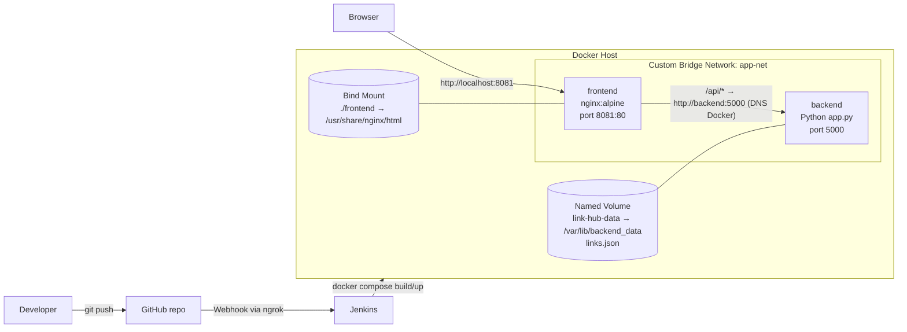

# Resource Link Hub – Repositori Tautan Modul Praktikum

UTS Cloud Computing – Cloud-Native Fullstack Application & Automated CI/CD Pipeline
**Studi Kasus No. 9: Repositori Tautan Modul Praktikum (Resource Link Hub)**

## Anggota Kelompok

| No | Nama | NIM |
|----|------|-----|
| 1 | Ahmad Naufal Romadhon | 101012300081 |
| 2 | ... | ... |
| 3 | ... | ... |
| 4 | ... | ... |

## Deskripsi

Portal agregator tautan modul, slide, dan materi praktikum. Pengguna bisa melihat, menambah, dan menghapus link materi. Data disimpan di file `links.json` di dalam Docker Named Volume `link-hub-data`, jadi data tidak hilang walaupun kontainer backend dihapus.

## Struktur Repositori

```
link-hub/
├── backend/
│   ├── app.py            # REST API Python (tanpa framework)
│   └── Dockerfile
├── frontend/
│   └── index.html        # HTML + Vanilla JS (fetch API)
├── nginx/
│   └── default.conf      # Konfigurasi Nginx + reverse proxy ke backend
├── docker-compose.yml
├── Jenkinsfile
└── README.md
```

## Diagram Arsitektur



```
Browser ──► :8081 ┌──────────────── app-net (bridge) ────────────────┐
                  │  [frontend: Nginx] ──/api/──► [backend: app.py]  │
                  │        ▲                         ▲               │
                  └────────┼─────────────────────────┼───────────────┘
                   Bind Mount ./frontend     Named Volume link-hub-data
                                                 (links.json)
```

- **Frontend** tidak memanggil IP backend, tapi Service Name `backend` (DNS internal Docker) melalui reverse proxy Nginx.
- **Backend** tidak membuka port ke host, hanya bisa diakses dari dalam network `app-net`.

## API Endpoint

| Method | Endpoint | Keterangan | Respon |
|--------|----------|------------|--------|
| GET | `/links` | Daftar semua link | 200 |
| POST | `/links` | Tambah link. Body: `{"title": "...", "url": "https://...", "category": "Modul"}` | 201 / 400 |
| DELETE | `/links?index=X` | Hapus link pada index X | 200 / 400 / 404 |
| GET | `/health` | Health check untuk Jenkins | 200 |

Dari host, API diakses lewat proxy: `http://localhost:8081/api/links`.

Contoh:
```bash
curl http://localhost:8081/api/links
curl -X POST http://localhost:8081/api/links -H "Content-Type: application/json" \
     -d '{"title":"Modul 1 Docker","url":"https://example.com/modul1","category":"Modul"}'
curl -X DELETE "http://localhost:8081/api/links?index=0"
```

## Instalasi Lokal

Prasyarat: Docker Desktop / Docker Engine dengan Docker Compose v2, Git.

```bash
git clone https://github.com/opallep/TUGAS-UTS-CC.git
cd TUGAS-UTS-CC
docker compose up -d --build
```

Buka **http://localhost:8081**.

Perintah berguna:
```bash
docker compose ps              # status kontainer
docker compose logs -f backend # log backend
docker volume ls               # cek volume link-hub-data
docker network inspect app-net # cek kontainer di network app-net
docker compose down            # matikan (volume TIDAK ikut terhapus)
```

### Uji Data Immunity (Named Volume)
```bash
# 1. Tambah beberapa link lewat UI
docker rm -f link-hub-backend      # 2. hapus paksa kontainer backend
docker compose up -d               # 3. jalankan lagi
# 4. Refresh UI → data masih ada
```

### Uji Bind Mount
Edit `frontend/index.html` (misal ganti judul), simpan, refresh browser → perubahan langsung muncul tanpa rebuild image.

## Setup Jenkins CI/CD

Lingkungan yang dipakai: Docker Desktop (Windows), Jenkins berjalan sebagai kontainer `jenkins-server` (image custom berbasis `jenkins/jenkins:lts-jdk17` + Docker CLI + python3) di network `jenkins-net` dengan `/var/run/docker.sock` di-mount, dan ngrok berjalan sebagai kontainer di network yang sama.

1. **Credential GitHub**: buat Personal Access Token (classic) dengan scope `repo` dan `admin:repo_hook`, lalu tambahkan di *Manage Jenkins → Credentials → Global → Add Credentials* (Kind: Username with password, username = akun GitHub, password = token).
2. **Buat Job**: *New Item → Pipeline* (nama: `link-hub-pipeline`)
   - Centang **GitHub hook trigger for GITScm polling**
   - Pipeline: *Pipeline script from SCM* → Git → URL repo → credential → Branch `*/main` → Script Path `Jenkinsfile`
3. **ngrok**: tunnel HTTPS publik diteruskan ke `jenkins-server:8080`.
4. **Webhook GitHub**: repo → *Settings → Webhooks → Add webhook*
   - Payload URL: `https://<domain-ngrok>/github-webhook/`
   - Content type: `application/json`, event: *Just the push event*
5. `git push` ke branch `main` → Jenkins otomatis menjalankan pipeline.

### Stage Pipeline
| Stage | Isi |
|-------|-----|
| 1. Checkout | Ambil kode terbaru dari GitHub |
| 2. Syntax Check | `python3 -m py_compile backend/app.py` + validasi `docker compose config` |
| 3. Build Image | `docker compose build` → image `link-hub-backend` |
| 4. Automated Deployment | Menyusun path host untuk Bind Mount, lalu `docker compose up -d` |
| 5. Health Check | Dari dalam kontainer frontend: `/api/health` (retry 10x), cek `index.html` tersaji, dan `/api/links` |

**Catatan Bind Mount di Jenkins:** karena Jenkins berjalan di dalam kontainer, path workspace `/var/jenkins_home/...` tidak dikenal Docker host. Stage 4 membaca sumber mount `/var/jenkins_home` milik kontainer Jenkins (`docker inspect`) lalu mengisi variabel `HOST_PROJECT_DIR`, sehingga Bind Mount `frontend/` tetap menunjuk ke folder hasil checkout terbaru.

## Video Demo

Link video: `<isi link YouTube/Drive>`
